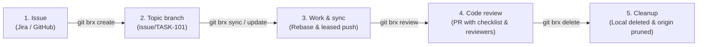

<div align="center">


# git-brx

**Opinionated Git branch workflow CLI**

[](https://github.com/bvarnai/git-brx/actions/workflows/ci.yml)
[](https://github.com/bvarnai/git-brx/releases)
[](https://github.com/bvarnai/scoop-bucket)
[](go.mod)
[](LICENSE)
[](https://github.com/bvarnai/git-brx/releases)

<p align="center">
  <a href="#why-git-brx">Why git-brx?</a> •
  <a href="#the-git-brx-philosophy">Core philosophy</a> •
  <a href="#quick-start">Quick start</a> •
  <a href="#platform-support">Platform support</a> •
  <a href="#installation">Installation</a> •
  <a href="#configuration">Configuration</a> •
  <a href="#documentation-wiki">User guide wiki</a>
</p>

</div>

---

## Why git-brx?

Git's low-level CLI makes everyday team workflows harder than they need to be. As teams grow, three problems show up repeatedly:

- **Destructive commands:** Engineers hesitate to rebase, sync, or clean up branches when a single wrong flag (`git push --force`, `git reset --hard`, `git checkout .`) can discard local work or overwrite a teammate's commits.
- **Inconsistent habits:** Without shared tooling, everyone invents their own aliases, branch names, and merge habits. Some squash locally, some create tangled merge histories, and others leave stale branches on `origin`.
- **Heavyweight branching models:** Complex branching models built for large release trains add unnecessary overhead for teams shipping continuously.

**`git-brx` wraps standard Git in a thin, guardrailed CLI.** It enforces consistent branch naming, automates rebase/merge decisions, prevents accidental history overwrites, and links every branch to an issue and pull request.

There is **no lock-in**: `git-brx` runs standard Git plumbing under the hood. You can mix `git-brx` and raw `git` commands at any time.

---

## The git-brx philosophy

### 1. Issue-first development
Every tracked code change starts with an issue in Jira or GitHub:
- **The issue defines "What" and "Why":** Context, requirements, edge cases, and acceptance criteria live in the issue tracker.
- **The pull request reviews "How":** Code review focuses on design, correctness, test coverage, and security—not rediscovering requirements.

### 2. Built-in safety rails
- Pushes default to `--force-with-lease` (`git brx publish`) so you never blindly overwrite a colleague's remote commits.
- Issue branches (`issue/*`) rebase linearly onto `main`, keeping history clean and bisectable.
- Conflict resolution (`git brx resolve`) opens your configured merge tool and stages **only** the resolved files—never `git add .`.
- Branch cleanup (`git brx delete`) checks that the branch has been merged and removed on `origin` before deleting local refs.

### 3. Convention over configuration
`git-brx` uses three branch prefixes (`issue/*`, `feature/*`, `epic/*`):
- **Consistent naming:** No bikeshedding over branch names.
- **Automated behavior:** The branch prefix determines whether `git brx sync` rebases or merges, and whether `git brx review` recommends a squash merge or a merge commit.
- **Local scratch work:** For throwaway spikes without an issue, use standard `git checkout -b my-spike`.

### 4. The branch lifecycle



---

## Quick start

Run the full branch lifecycle in 5 commands:

```bash
# 1. Validate the issue in your tracker and create the topic branch
git brx create issue/TASK-101

# ... write code, make regular git commits ...

# 2. Rebase onto the latest main branch
git brx sync

# 3. Push to origin with --force-with-lease and set upstream tracking
git brx publish

# 4. Open a pull request with automated reviewer routing and merge instructions
git brx review

# ... PR is approved and merged on GitHub / Bitbucket ...

# 5. Verify remote deletion, switch back to main, and prune the local branch
git brx delete
```

---

## Available commands

Once `git-brx` is in your `PATH`, Git automatically exposes it as `git brx <command>`:

| Command | Purpose |
| :--- | :--- |
| [`git brx create`](docs/user-guide/branch-lifecycle.md#2-branch-creation-git-brx-create) | Validates the issue in your tracker and creates a local topic branch. |
| [`git brx select`](docs/user-guide/branch-lifecycle.md#3-branch-switching--exploration-git-brx-select-name-history) | Fetches remotes and switches branches with typo suggestions and dirty-tree warnings. |
| [`git brx sync`](docs/user-guide/synchronization-and-rebasing.md#1-synchronizing-with-base-git-brx-sync) | Syncs the active branch with base (rebases `issue/*`, merges `feature/*` and `epic/*`). |
| [`git brx update`](docs/user-guide/synchronization-and-rebasing.md#2-updating-from-remote-git-brx-update) | Rebases local commits onto `origin/<current-branch>`. |
| [`git brx resolve`](docs/user-guide/synchronization-and-rebasing.md#3-resolving-conflicts-git-brx-resolve) | Runs your configured merge tool on conflicted files and continues the rebase/merge. |
| [`git brx reset`](docs/user-guide/synchronization-and-rebasing.md#4-recovery-git-brx-reset) | Aborts any active rebase/merge and hard-resets to `origin/<current-branch>`. |
| [`git brx publish`](docs/user-guide/branch-lifecycle.md#4-leased-publishing-git-brx-publish) | Pushes the current branch to `origin` with `--force-with-lease` and sets upstream tracking. |
| [`git brx review`](docs/user-guide/branch-lifecycle.md#5-code-review-submission-git-brx-review) | Opens a pull request with automated reviewer assignment and merge instructions. |
| [`git brx delete`](docs/user-guide/branch-lifecycle.md#6-safe-post-merge-deletion-git-brx-delete) | Verifies remote branch deletion, switches to `main`, and deletes the local branch. |
| [`git brx history`](docs/user-guide/command-reference.md#git-brx-history) | Prints a formatted commit graph (supports `--topic` branch filtering). |
| [`git brx name`](docs/user-guide/command-reference.md#git-brx-name) | Prints the active branch name to `stdout` for use in scripts. |
| [`git brx config`](docs/user-guide/command-reference.md#git-brx-config) | Prints the resolved cascading configuration and source provenance in YAML. |
| [`git brx completion`](docs/spec/completion.md) | Generates shell completion scripts (`bash`, `zsh`, `fish`, `powershell`). |

All commands accept `--help` (`-h`), `--verbose` (`-v`), `--quiet` (`-q`), and `--no-color`.

---

## Platform support

| Platform / Backend | Issue tracker | Code review (PR / MR) | Status | Notes |
| :--- | :--- | :--- | :--- | :--- |
| ✅ **GitHub** | GitHub Issues | GitHub Pull Requests | **Done** | Tested and verified against GitHub.com |
| ⌛ Atlassian (Bitbucket + Jira) | Jira Server / DC | Bitbucket Server / DC | *Implemented (untested)* | Client and contract tests implemented; not yet verified on live instances |
| 🚧 Hybrid (Jira + GitHub) | Jira Server / DC | GitHub Pull Requests | *Implemented (untested)* | Client implemented; needs live verification |
| 🚧 GitLab | GitLab Issues | GitLab Merge Requests | Not yet implemented | Planned |
| 🚧 Bitbucket Cloud | Jira Cloud / Bitbucket | Bitbucket Cloud PRs | Not yet implemented | Planned |

See the [Supported platforms & integration matrix](docs/user-guide/multi-platform.md) and the [GitHub integration guide](docs/user-guide/platforms/github.md) for setup details.

---

## Installation

### Precompiled binary (Linux / macOS)
Download and extract the latest release to `/usr/local/bin`:
```bash
curl -sSL https://github.com/bvarnai/git-brx/releases/latest/download/git-brx_linux_amd64.tar.gz | tar -xz
sudo mv git-brx /usr/local/bin/
```

### Via Scoop (Windows)
Install `git-brx` on Windows with [Scoop](https://scoop.sh/):
```powershell
scoop bucket add bvarnai https://github.com/bvarnai/scoop-bucket
scoop install git-brx
```

### Via Go install (Go 1.22+)
```bash
go install github.com/bvarnai/git-brx/cmd/git-brx@latest
```

### From source
```bash
git clone https://github.com/bvarnai/git-brx.git
cd git-brx
go build -o /usr/local/bin/git-brx ./cmd/git-brx
```

Verify the installation:
```bash
git brx --version
# git-brx version v1.2.0 (86d244b linux/amd64)
```

---

## Configuration

`git-brx` requires **no configuration file** for standard GitHub repositories—it detects your platform, owner, and repo directly from `remote.origin.url`.

To customize reviewer routing or branch mappings for your repo, add `.git-brx.yaml` to the repository root:

```yaml
# Preset platform ('github' or 'bitbucket')
platform: github

# Reviewer routing based on modified paths or issue labels
review:
  merge:
    instructions: true
  template: .github/pull_request_template.md
  mapping:
    labels:
      backend: [alice, bob]
      frontend: [carol, dave]
    default: [charlie]
```

See the [Configuration guide](docs/user-guide/getting-started.md#3-configuration-cascade) for all options.

---

## Documentation wiki

- 📖 **[User guide index](docs/user-guide/README.md)**: Table of contents and reading paths.
- 🎯 **[Philosophy & mental model](docs/user-guide/philosophy.md)**: Issue-driven workflow, branch roles, and PR hygiene.
- 🚀 **[Getting started](docs/user-guide/getting-started.md)**: Installation, shell completion, credentials, and configuration cascade.
- 🔄 **[Branch lifecycle guide](docs/user-guide/branch-lifecycle.md)**: Walkthrough from `create` to `delete`.
- ⚡ **[Synchronization & rebasing](docs/user-guide/synchronization-and-rebasing.md)**: Rebasing with `sync` and `update`, resolving conflicts, and resetting.
- 🌐 **[Supported platforms & matrix](docs/user-guide/multi-platform.md)**: Platform support and setup guides for [GitHub](docs/user-guide/platforms/github.md) and [Atlassian](docs/user-guide/platforms/atlassian.md).
- 📚 **[Command reference](docs/user-guide/command-reference.md)**: Flags, arguments, and examples for every command.
- 💡 **[Troubleshooting & FAQ](docs/user-guide/troubleshooting-faq.md)**: Common errors and recovery steps.
- 🤖 **[AI Assistant Rule Template](templates/rules/git-brx.md)**: Workspace rule for AI coding agents.
- 🧠 **[Antigravity / Agent Skill](templates/skills/git-brx/SKILL.md)**: Workflow runbook skill for coding agents.

---

## Contributing

See [CONTRIBUTING.md](CONTRIBUTING.md) for architecture rules, test requirements, and branch workflow. Command specifications live in [`docs/spec/`](docs/spec/global.md).

---

## License

Licensed under the [MIT License](LICENSE).

---

## 🤖 AI Disclosure


Developed with the assistance of AI tools. All AI-generated code is reviewed, tested, and refined by human maintainers.
