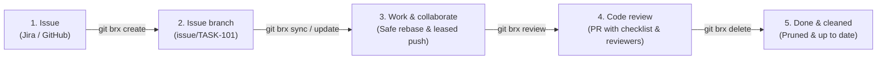

<div align="center">


# git-brx

**Opinionated, simple Git workflow driven by easy commands**

[](https://github.com/bvarnai/git-brx/actions/workflows/ci.yml)
[](https://github.com/bvarnai/git-brx/releases)
[](https://github.com/bvarnai/scoop-bucket)
[](go.mod)
[](LICENSE)
[](https://github.com/bvarnai/git-brx/releases)

<p align="center">
  <a href="#why-git-brx">Why git-brx?</a> •
  <a href="#the-git-brx-philosophy">Core philosophy</a> •
  <a href="#quick-start">Quick start</a> •
  <a href="#platform-support">Platform support</a> •
  <a href="#installation">Installation</a> •
  <a href="#configuration">Configuration</a> •
  <a href="#documentation-wiki">User guide wiki</a>
</p>

</div>

---

## Why git-brx?

While Git is the industry standard, its complex command-line interface and steep learning curve make everyday collaboration difficult. As teams grow, several systemic problems reliably emerge:

- **Fear of breaking things:** New hires and junior engineers hesitate to rebase, synchronize, or clean up branches because one wrong command (`git push --force`, `git reset --hard`, `git checkout .`) can silently discard hours of work or overwrite a teammate's commits
- **Inconsistent team habits:** Without standard tooling, every developer invents their own ad-hoc aliases, naming conventions, and merge practices. Some squash locally, some create tangled merge webs, and some leave dozens of abandoned branches lingering on the remote
- **Overengineered workflows:** Many teams suffer under heavy, bureaucratic branching models designed for massive enterprises with dedicated DevOps support. Smaller or fast-moving teams need a clean, lightweight flow that just works without overhead

**`git-brx` eliminates this friction.** It acts as a thin, guardrailed layer over Git that hides low-level complexity, prevents disastrous mistakes, and gives teams a simple, intuitive workflow from task creation to merged code.

Best of all, there is **zero lock-in**: `git-brx` is pure Git under the hood. Use it alongside standard Git commands or stop anytime—nothing breaks.

---

## The git-brx philosophy

### 1. Issue-first development
In `git-brx`, **every code change begins with a ticket in your issue tracker** (whether it's a Jira issue, GitHub issue, or user story):
- The **ticket** defines **"What"** and **"Why"**: Business context, specifications, edge cases, and acceptance criteria live exclusively in the issue tracker
- The **pull request** inspects **"How"**: Code review discussions are strictly technical—evaluating architecture, code quality, test coverage, and security. Reviewers don't have to rediscover missing requirements during code review because the issue is already the single source of truth

### 2. Guardrailed, fearless collaboration
You don't need to be a Git wizard to work safely:
- All remote pushes use leased safety (`--force-with-lease`) to prevent stale branch overwrites
- Branch synchronization defaults to clean linear rebasing for issue tasks, keeping `main`/`master` bisectable
- Conflict resolution (`git brx resolve`) interactively launches your GUI merge tool and stages **only** the conflicting files—never indiscriminate directory staging
- Deleting a branch (`git brx delete`) verifies that your PR has been merged on the remote platform first

### 3. Convention over configuration
Rather than letting every developer invent ad-hoc branch names, `git-brx` standardizes on clean, issue-linked prefixes (`issue/*`, `feature/*`, `epic/*`):
- *Zero decision fatigue:* Standardized naming means onboarding is instant and team history stays consistent
- *Powers intelligent automation:* The branch prefix tells `git-brx` whether to rebase or merge on `sync`, how to format PR titles, and when a branch is safe to delete
- *Scratch work friendly:* For local spikes, prototypes, or throwaway experiments without an issue, raw Git (`git checkout -b my-experiment`) remains 100% available alongside `git-brx`

### 4. The branch lifecycle



---

## Quick start

Experience the full branch workflow with just 5 commands:

```bash
# 1. Create and checkout a validated branch linked to your tracker
git brx create issue/TASK-101

# ... write code, make regular git commits ...

# 2. Keep up-to-date with main/master cleanly via rebase
git brx sync

# 3. Publish to remote with safe lease and upstream tracking
git brx publish

# 4. Open a pull request with automated reviewer assignment and merge instructions
git brx review

# ... PR is approved and merged on GitHub / Bitbucket ...

# 5. Verify remote deletion, switch to main, and prune local branch
git brx delete
```

---

## Available commands

When installed in your `PATH`, `git-brx` is automatically available as a native Git plugin via `git brx <command>`:

| Command | Purpose |
| :--- | :--- |
| [`git brx create`](docs/user-guide/branch-lifecycle.md#1-branch-creation) | Validates against issue tracker and provisions topic branch. |
| [`git brx select`](docs/user-guide/branch-lifecycle.md#2-branch-switching) | Safely switches branches with typo suggestions and uncommitted change warnings. |
| [`git brx sync`](docs/user-guide/synchronization-and-rebasing.md#1-synchronizing-with-base-git-brx-sync) | Synchronizes active branch with base (rebase for issues, merge for features). |
| [`git brx update`](docs/user-guide/synchronization-and-rebasing.md#2-updating-from-remote-git-brx-update) | Rebase-pulls remote upstream commits into local branch. |
| [`git brx resolve`](docs/user-guide/synchronization-and-rebasing.md#3-resolving-conflicts-git-brx-resolve) | Launches your GUI merge tool and continues in-flight rebase or merge. |
| [`git brx reset`](docs/user-guide/synchronization-and-rebasing.md#4-safe-recovery-git-brx-reset) | Aborts in-flight rebases/merges and restores clean state from remote tracking ref. |
| [`git brx publish`](docs/user-guide/branch-lifecycle.md#3-leased-publishing) | Pushes branch to remote with `--force-with-lease` and configures upstream tracking. |
| [`git brx review`](docs/user-guide/branch-lifecycle.md#4-code-review-submission) | Creates a pull request with reviewer routing and timeless merge instructions. |
| [`git brx delete`](docs/user-guide/branch-lifecycle.md#5-safe-post-merge-deletion) | Verifies remote PR merge, switches to `main`, and safely deletes local branch. |
| [`git brx history`](docs/user-guide/command-reference.md#git-brx-history) | Renders a formatted commit graph (with `--topic` delta filtering). |
| [`git brx name`](docs/user-guide/command-reference.md#git-brx-name) | Prints the active branch name (plumbing-safe for scripts). |
| [`git brx config`](docs/user-guide/command-reference.md#git-brx-config) | Displays the effective cascading configuration and source provenance in YAML format. |

All commands support `--help`, `-h`, and `--dry-run` (`-n`) for safe previewing.

---

## Platform support

`git-brx` interacts with issue trackers and code review systems. Current platform support status:

| Platform / Backend | Issue tracker | Code review (PR / MR) | Status | Notes |
| :--- | :--- | :--- | :--- | :--- |
| ✅ **GitHub** | GitHub issues | GitHub pull requests | **Done** | Tested and verified in real-world usage |
| ⌛ Atlassian (Bitbucket + Jira) | Jira Server / DC | Bitbucket Server / DC | *Implemented (untested)* | Client code and unit tests present; not yet tested on live instances |
| 🚧 Hybrid (Jira + GitHub) | Jira Server / DC | GitHub pull requests | *Implemented (untested)* | Client code present; needs real-world testing |
| 🚧 GitLab | GitLab Issues  | GitLab merge requests | Not yet implemented | Planned for future release |
| 🚧 Bitbucket Cloud | Jira Cloud / Bitbucket | Bitbucket cloud PRs | Not yet implemented | Planned for future release |

See the [Supported platforms & integration matrix](docs/user-guide/multi-platform.md) or the [GitHub integration guide](docs/user-guide/platforms/github.md) for configuration details.

---

## Installation

### Pre-built binaries
Download the latest release for Linux, macOS, or Windows from the [Releases](https://github.com/bvarnai/git-brx/releases) page. Extract and place `git-brx` in your `PATH` (e.g. `/usr/local/bin` or `~/bin`).

### Windows (Scoop)
You can install `git-brx` on Windows via [Scoop](https://scoop.sh/):
```powershell
scoop bucket add bvarnai-bucket https://github.com/bvarnai/scoop-bucket
scoop install git-brx
```

### From source (Go >= 1.22)
```bash
git clone https://github.com/bvarnai/git-brx.git
cd git-brx
go build -o /usr/local/bin/git-brx ./cmd/git-brx
```

Verify your installation:
```bash
git brx --version
# git-brx version v1.0.0 (commit: abc1234, built at: 2026-10-09, linux/amd64)
```

---

## Configuration

`git-brx` works out-of-the-box with **zero configuration** by auto-detecting your remote origin URL (`github.com`, Bitbucket Server, etc.).

For team-wide customizations, add `.git-brx.yaml` to the root of your repository:

```yaml
# Preset platform ('github' or 'bitbucket')
platform: github

# Reviewer routing based on affected components/labels
review:
  instructions: true
  template: .github/pull_request_template.md
  mapping:
    backend: [alice, bob]
    frontend: [carol, dave]
    default: [charlie]
```

See [Configuration guide](docs/user-guide/getting-started.md#configuration-cascade) for detailed options.

---

## Documentation wiki

Explore the complete user guide and technical manuals:

- 📖 **[User guide index](docs/user-guide/README.md)**: Full table of contents.
- 🎯 **[Philosophy & principles](docs/user-guide/philosophy.md)**: Deep dive on the mental model, psychological safety, and issue-driven development.
- 🚀 **[Getting started](docs/user-guide/getting-started.md)**: Setup, credentials, and configuration cascade.
- 🔄 **[Branch lifecycle guide](docs/user-guide/branch-lifecycle.md)**: Step-by-step from branch creation to post-merge deletion.
- ⚡ **[Synchronization & rebasing](docs/user-guide/synchronization-and-rebasing.md)**: Rebase workflows, resolving conflicts, and resetting.
- 🌐 **[Supported platforms & matrix](docs/user-guide/multi-platform.md)**: Compatibility matrix and dedicated guides for [GitHub](docs/user-guide/platforms/github.md) and [Atlassian](docs/user-guide/platforms/atlassian.md).
- 📚 **[Command reference](docs/user-guide/command-reference.md)**: Comprehensive reference for all commands and flags.
- 💡 **[Troubleshooting & FAQ](docs/user-guide/troubleshooting-faq.md)**: Common questions and diagnostic solutions.

---

## License

This project is licensed under the [MIT License](LICENSE).

---

## 🤖 AI Disclosure


This project was developed with the assistance of AI tools. All AI-generated code has been reviewed, tested, and manually refined.
