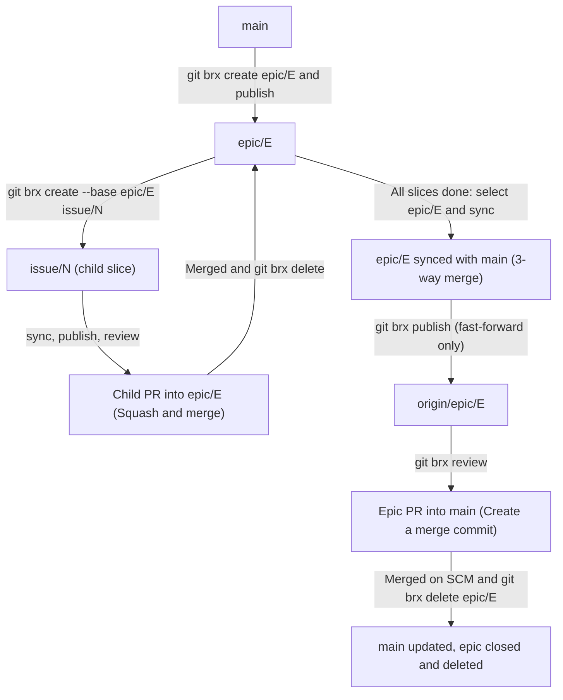

# The branch lifecycle

This guide walks through the lifecycle of a branch in `git-brx`, from creating a validated work branch to cleaning it up after merge.

---

## 1. Branch taxonomy & lifecycle strategies

`git-brx` maps every branch prefix to a default `sync` strategy and pull request merge strategy:

| Branch type | Scope & purpose | Lifespan | Default `sync` strategy | Default PR merge strategy |
| :--- | :--- | :--- | :--- | :--- |
| **`issue/<id>`** | Bug fixes, small tasks, tech debt | Short-lived | **Rebase** (`git rebase`) | **Squash & merge** |
| **`feature/<id>`** | Backlog stories, multi-person features | Short-to-medium | **Merge** (`git merge`) | **Squash & merge** *(or Merge commit)* |
| **`epic/<id>`** | Multi-PR initiatives | Long-lived | **Merge** (`git merge`) | **Merge commit (`--no-ff`)** |
| **`release/<version>`** *(optional)* | Optional release stabilization or maintenance / backporting | On demand / maintained | N/A *(or explicit `--merge`)* | Tagged *(not required for simple releases)* |
| **`main` / `master`** | Default base branch | Permanent | N/A | Protected base branch |

### Why `sync` strategies differ by prefix
* **`issue/*` $\to$ Rebase:** Bug fixes and small tasks are usually single-author branches. Rebasing onto `main` keeps commit history linear and prepares the branch for a clean squash merge.
* **`feature/*` and `epic/*` $\to$ Merge:** Shared or long-running (multi-PR) branches often have multiple contributors. Merging `main` into the branch avoids rewriting commit history under teammates working on the same branch.
* **Overriding the default:** Pass `--rebase` (`-r`) or `--merge` (`-m`) to `git brx sync` at any time.

### Optional release branches
`release/*` branches are **not required** for every project or release:
* **Default (tag `main` directly):** For single-version services, libraries, or CLIs that ship forward from `main`, tag releases directly on `main` (e.g., `v1.3.0`) without creating a `release/*` branch.
* **On-demand maintenance & backporting:** You do not need to pre-create `release/*` branches up front. If an older release ever needs a patch after `main` has moved on, create `release/<version>` retroactively from the release tag (`git checkout -b release/1.x v1.3.0`).
* **Upfront release stabilization:** Branch `release/<version>` from `main` before tagging only when a release requires an isolated QA or stabilization window while `main` stays open for new work.
* **Built-in `git-brx` support when used:** Fork fixes with `git brx create --base release/1.x issue/<id>` so `sync`, `history --delta`, `review`, and `delete` automatically target `release/1.x`. `git brx publish` enforces fast-forward-only pushes on `release/*`, and `git brx delete` blocks accidental deletion.

> [!NOTE]
> **Convention over configuration:** Tracked branches follow the `<type>/<id>` pattern so `git-brx` knows how to sync, review, and clean them up. For local throwaway experiments, use standard Git (`git checkout -b scratch-spike`).

> [!TIP]
> **Branch protection & force-pushes:** Protect base branches (`main`, `master`, `release/*`) against direct pushes, deletions, and force-pushes, and protect integration branches (`epic/*`) against force-pushes (fast-forward only), while allowing `--force-with-lease` pushes on `issue/*` and `feature/*` branches. See [Branch protection rules & repository permissions](multi-platform.md#5-branch-protection-rules--repository-permissions) for details.

---

## 2. Branch creation (`git brx create`)

Create a new branch linked to an issue:

```bash
git brx create issue/task-101
```

### Execution steps
1. **Worktree check:** Verifies that you are inside a Git worktree with no in-flight merge or rebase.
2. **Collision auto-switch:**
   - If the branch already exists locally or on `origin`, `git-brx` fetches if needed, safely switches to that branch (fast-forwarding clean branches behind `origin/<branch>`), and exits `0`.
3. **Name validation:** Matches the branch name against `branch.template` (e.g., `issue/<KEY>`, `feature/<KEY>`, `epic/<KEY>`).
4. **Issue tracker lookup:**
   - Queries GitHub Issues or Jira for `task-101`.
   - Verifies that the issue type/labels are allowed for the target branch prefix (e.g., `bug` $\to$ `issue/`) and prints the issue title, status, assignee, and URL.
   - Prompts `Create branch 'issue/task-101' [Y/n]?` (pass `-y` / `--yes` to skip the prompt in scripts).
5. **Base guardrails & checkout:** Validates `--base <branch>` if provided (or warns when forking from another `issue/*` or `feature/*` branch, a behind-origin base, or a dirty worktree), runs `git checkout -b issue/task-101 [<base>]`, and records `branch.<name>.brx-base` in local `.git/config`.

### Offline mode
When working without network access, pass `--offline` (`-o`):
```bash
git brx create --offline issue/task-101
```
This skips the remote ref check and issue tracker lookup, validating only the local branch name syntax.

---

## 3. Branch switching & exploration (`git brx select`, `name`, `history`)

### Switching branches (`git brx select`)
```bash
# Switch to the default branch (main or master):
git brx select

# Switch to a specific branch:
git brx select issue/task-101
```

**What `select` does:**
- **Fetches remotes:** Runs `git fetch` before switching (unless `--offline` is passed).
- **Auto-fast-forward & behind-upstream hint:** When online and clean, if the target branch is strictly behind `origin/<branch>`, `git-brx` automatically fast-forwards it (`--ff-only`, unless `--no-ff` is passed). When dirty, diverged, or `--no-ff` is active, it prints a hint:
  ```text
  [git-brx] Already on 'issue/task-101'
  [git-brx] Hint: Your branch is behind 'origin/issue/task-101' by 2 commit(s). Run 'git-brx update' to update.
  ```
- **Typo suggestions:** If the target branch doesn't exist, `git-brx` suggests close matches using Levenshtein distance:
  ```text
  [git-brx] Error: Branch 'featrue/login' not found
  [git-brx] Hint: Did you mean 'feature/login'?
  ```
- **Dirty working tree warning:** Warns if uncommitted local changes are carried over into the newly checked-out branch.

### Printing the current branch (`git brx name`)
Prints the active branch name to `stdout` with no prefix, suitable for shell scripts:
```bash
CURRENT=$(git brx name)
echo "Active branch is $CURRENT"
```
If HEAD is detached, it writes the short commit SHA to `stdout` and logs a warning to `stderr`.

### Viewing commit history (`git brx history`)
Renders a compact commit graph:
```bash
# Show the last 10 commits:
git brx history -l 10

# Show only commits on the current branch since diverging from base:
git brx history --delta

# Search commit messages:
git brx history -s "database migration"

# Include file diffstats:
git brx history --stat
```

---

## 4. Leased publishing (`git brx publish`)

Push your branch to `origin` and configure upstream tracking:

```bash
git brx publish
```

### Default `--force-with-lease` protection
Raw `git push` fails after a rebase, while `git push --force` blindly overwrites commits pushed by teammates.

`git brx publish` pushes with **`--force-with-lease`** by default on `issue/*`, `feature/*`, and custom branches, and always enforces **fast-forward-only** pushes (never `--force-with-lease`) on shared `epic/*` and `release/*` integration branches so child branches forked from them stay intact:
- Sets upstream tracking (`--set-upstream origin <branch>`) on first push.
- Rejects the push if `origin/<branch>` has commits you haven't fetched yet:
  ```text
  [git-brx] Error: Publish rejected: remote has newer commits
  [git-brx] Hint: Run 'git-brx update' to incorporate remote changes before publishing
  ```

---

## 5. Code review submission (`git brx review`)

Open a pull request from your published branch:

```bash
git brx review
```

### How `review` builds the pull request
1. **Remote sync & target check:** Verifies that local `HEAD` matches `origin/<branch>`, resolves `<target_branch>` (explicit argument $\to$ recorded `branch.<name>.brx-base` $\to$ default branch), and verifies `<target_branch>` exists on `origin`.
2. **Issue metadata lookup:** Extracts the issue key from the branch name and fetches the issue title and labels from GitHub or Jira.
3. **Reviewer routing:** Evaluates `review.mapping` in `.git-brx.yaml` in order of precedence (skipped when `--draft` is set unless `-r` is passed):
   - **CLI override:** `-r, --reviewer <user>` (repeatable or comma-separated, deduplicated).
   - **Changed file paths (`mapping.paths`):** Matches modified files against `origin/<target>...HEAD` (falling back to `<target>...HEAD`) globs (e.g., `internal/ui/**`, `docs/**`) and aggregates all matched reviewers.
   - **Issue labels (`mapping.labels`):** If no path rules match, checks GitHub labels or Jira components.
   - **Branch globs (`mapping.branches`):** If no label rules match, checks the source branch name (e.g., `epic/*`).
   - **Default fallback (`mapping.default`):** Used when no earlier rules match.
   - **Author exclusion:** Removes the PR author from the resolved reviewer list.
4. **PR body generation:** Loads your configured `review.template` (or auto-discovers a repository PR template), adds the issue closing reference (`Closes #<id>`), and appends **Merge instructions**:
   ```markdown
   Closes #task-101

   ### Merge instructions
   - **Strategy:** Squash and merge (recommended)
     - **Commit:** `fix(#task-101): add user authentication API` (all commits squashed into a single commit)
   - **Branch cleanup:** Delete source branch `issue/task-101` after merging
   ```
   - `issue/*` and `feature/*` branches default to **Squash and merge** (whether targeting `main` or `epic/*`).
   - `epic/*` branches infer `epic(<scope>):` for unprefixed issue titles, default to **Create a merge commit** with descriptive merge instructions (`Merge branch 'epic/<id>' into <target>: <summary>`), and automatically append `Closes #<N>` lines from merged child PRs targeting the epic (warning when total closing references exceed GitHub's 10-issue auto-close limit). `release/*` branches also default to **Create a merge commit** when acting as the PR source branch.
   - Override the merge strategy for a specific PR with `-s, --strategy <squash|merge|rebase>` or create a draft PR with `--draft`:
     ```bash
     git brx review -s merge
     git brx review --draft
     ```
5. **API submission:** Creates the PR via the GitHub or Bitbucket Server REST API (emitting a warning if reviewer assignment returns an API error, or including the existing PR URL on 409 conflicts) and prints the PR URL to `stdout`.

---

## 6. Safe post-merge deletion (`git brx delete`)

After your pull request is merged on GitHub or Bitbucket, clean up the branch:

```bash
git brx delete
```

### Execution steps
1. **Remote deletion check:** Verifies via `git ls-remote --heads origin <branch>` that the branch has already been deleted on `origin`.
2. **SCM status check & `--delete-remote`:** If the branch still exists on `origin`, `git-brx` queries the SCM API (prioritizing `OPEN > MERGED > CLOSED` across reused branch names):
   - **PR still open:** Blocks deletion (even with `--delete-remote`) and prints the open PR URL.
   - **PR merged (remote branch still present):** Pass `--delete-remote` to delete `origin/<branch>` automatically before removing the local branch, or delete it manually / pass `--force` (`-f`).
3. **Switch to parent or default base branch:** If currently on `<branch>`, returns to the recorded `branch.<branch>.brx-base` (or `main`/`master`) and fast-forwards it automatically when clean and behind `origin`. In linked worktrees where the return branch is checked out elsewhere (or remote-only), detaches `HEAD` onto `origin/<return>` instead of failing checkout.
4. **Local cleanup:** Runs `git branch -D <branch>` and `git remote prune origin`.
5. **Update hint:** When switched to an unfetched/dirty return branch without auto-fast-forwarding, prints a hint to run `git-brx update`.
   ```text
   [git-brx] Deleted local branch 'issue/task-101' and pruned origin
   [git-brx] Hint: Your local 'main' may not be up-to-date. Use 'git-brx update' to update changes
   ```

---

## 7. Multi-PR epic lifecycle

An `epic/<id>` branch is an integration branch that aggregates multiple child pull requests (`issue/*` or `feature/*`) for a multi-PR initiative. Epics follow the same `create` $\to$ `sync` $\to$ `publish` $\to$ `review` $\to$ `delete` lifecycle against `main`, with child PRs nested inside, and are closed and deleted once merged into `main`.



### 1. Provision and publish the epic branch

Ensure the parent epic issue `#<E>` has the `epic` label in your issue tracker (on GitHub, create the `epic` label in repository settings if it does not exist yet), then branch from an up-to-date `main` and publish immediately so child slices can target `origin/epic/<E>`:

```bash
git brx select main
git brx update
git brx create epic/<E>
git brx publish
```

- `git brx create` records `branch.epic/<E>.brx-base=main` in local Git config.
- `git brx publish` enforces fast-forward-only pushes on `epic/*` (never `--force-with-lease`), protecting shared integration history under child branches.

### 2. Fork and merge child slices into the epic

Create each child slice with `--base epic/<E>` (or after `git brx select epic/<E>`):

```bash
git brx create --base epic/<E> issue/<N>
```

Because `create` records `branch.issue/<N>.brx-base=epic/<E>`, every subsequent command targets `epic/<E>` automatically without repeating `<target_branch>`:

```bash
# Rebase onto latest origin/epic/<E>, push, and open child PR against epic/<E>:
git brx sync
git brx publish
git brx review
```

- Child `issue/*` and `feature/*` PRs targeting `epic/<E>` default to **Squash and merge** instructions.
- After the child PR merges into `epic/<E>`, clean up locally:
  ```bash
  git brx delete
  ```
  `git brx delete` switches back to `epic/<E>` (fast-forwarding it automatically if clean and behind `origin/epic/<E>`), deletes local `issue/<N>`, and prunes `origin`.

### 3. Close and merge the completed epic into `main`

Once all child slices are merged into `epic/<E>`, integrate `main` and open the final epic pull request:

```bash
git brx select epic/<E>
git brx sync
git brx publish
git brx review
```

- **`sync`:** Merges `main` into `epic/<E>` with a 3-way merge commit (`Merge branch 'main' into 'epic/<E>'`) rather than rebasing, keeping merged slice history intact.
- **`publish`:** Pushes `epic/<E>` fast-forward-only to `origin`.
- **`review`:**
  - Targets `main` (via recorded `branch.epic/<E>.brx-base`).
  - Formats the PR title with the `epic(#<E>): <title>` prefix.
  - Emits `Closes #<E>` and automatically aggregates unique `Closes #<N>` references from all merged child PRs targeting `epic/<E>` (logging a warning if the total exceeds GitHub's 10-issue auto-close limit).
  - Appends **Create a merge commit** instructions (`Merge branch 'epic/<E>' into main: <summary>`) instead of squash, preserving the squashed child slice commits on `main`.
- **Merge on GitHub / Bitbucket:** Merge the PR using **Create a merge commit** (not *Squash and merge*) so child commit history is preserved and `#<E>` plus its child issues close automatically.

### 4. Delete the closed epic branch

After the epic PR merges into `main`, remove the local epic branch and fast-forward `main`:

```bash
git brx delete epic/<E>
# Or, if GitHub "Automatically delete head branches" is disabled:
git brx delete --delete-remote epic/<E>
```

`git brx delete` switches back to `main`, auto-fast-forwards local `main` when clean and behind `origin/main`, deletes local `epic/<E>`, and prunes `origin`.

> [!NOTE]
> **Epics close on merge to `main`:** An `epic/<id>` branch is closed and deleted when merged into `main` rather than kept open in parallel with `main`. Start follow-up initiatives on a new `epic/<id>` branch.
