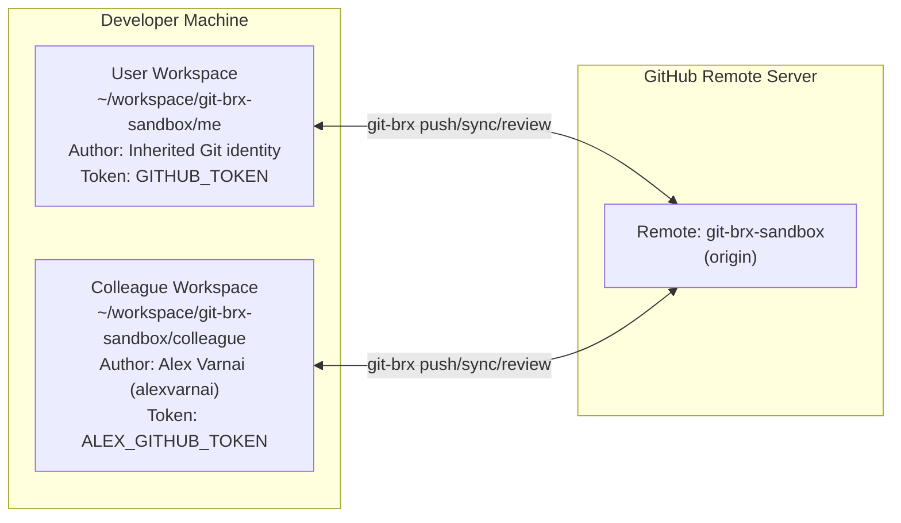

# Colleague simulation & multi-developer testing guide

Testing multi-developer Git workflows—rebasing over upstream merges, resolving merge conflicts, and sharing feature branches—usually requires a second developer or manual context-switching between local clones.

`git-brx` includes a **Colleague Simulation Harness** built around **"Alex Varnai"** (`alexvarnai` on GitHub, `alexvarnai@users.noreply.github.com`), an AI peer agent running in Antigravity CLI (`agy`). Alex works in a separate clone with a dedicated Git author identity and personal access token (`ALEX_GITHUB_TOKEN`), letting you test multi-developer scenarios, reviewer routing, and author exclusion side by side.

---

## 1. Architecture & workspace topology



### Separate identities
Both clones push to the same GitHub repository (`git-brx-sandbox`), using separate local Git configs and API tokens:
- **User workspace (`git-brx-sandbox/me`):** Uses your global Git identity (`user.name`/`user.email`) and `GITHUB_TOKEN`.
- **Colleague workspace (`git-brx-sandbox/colleague`):** Uses Alex's identity (`Alex Varnai <alexvarnai@users.noreply.github.com>`, GitHub user `alexvarnai`) and `ALEX_GITHUB_TOKEN`.

---

## 2. One-time setup & shell activation

Run the sandbox setup script from the `git-brx` root:

```bash
ADMIN_GITHUB_TOKEN="ghp_..." \
ME_GITHUB_TOKEN="github_pat_..." \
ALEX_GITHUB_TOKEN="ghp_..." \
./scripts/setup-sandbox.sh
```

### GitHub token permissions

The setup script uses three tokens:

| Token role | Environment variable | Account | Required scope / permissions | Purpose |
| :--- | :--- | :--- | :--- | :--- |
| **Admin Token** | `ADMIN_GITHUB_TOKEN` | Primary (`bvarnai`) | **Classic PAT** (`repo`, `admin:repo_hook`) or Admin fine-grained PAT | Creates/resets `git-brx-sandbox`, invites `alexvarnai` as collaborator, and seeds issues |
| **Primary Developer** | `ME_GITHUB_TOKEN` | Primary (`bvarnai`) | **Fine-grained PAT** (`git-brx-sandbox`):<br>• **Contents:** `Read-only` *(required for private repos)*<br>• **Pull requests:** `Read and write`<br>• **Issues:** `Read-only`<br>• **Metadata:** `Read-only` | Written to `env.sh` for commands run in `git-brx-sandbox/me` (`create`, `publish`, `review`, `delete`) |
| **Colleague** | `ALEX_GITHUB_TOKEN` | Colleague (`alexvarnai`) | **Classic PAT** (`repo` scope) *(required for personal private repos)*<br>or Fine-grained PAT *(GitHub Organizations)* | Written to `env-colleague.sh` for Alex's commands in `git-brx-sandbox/colleague` |

> [!NOTE]
> **GitHub personal repositories vs. organizations:**
> * **Personal private repos (`git-brx-sandbox`):** GitHub blocks fine-grained PATs (`github_pat_...`) from accessing private repositories owned by another personal user account—even for invited collaborators (returns `404 Not Found`). For personal private repos, `ALEX_GITHUB_TOKEN` must be a **Classic PAT (`ghp_...`)** with `repo` scope.
> * **GitHub Organizations:** In organization repositories (e.g., `github.com/my-org/service`), fine-grained PATs work for all organization members.

> [!IMPORTANT]
> **Why `Contents: Read-only` is required on private repositories:**
> * On **public** repos, GitHub allows tokens to read commits and refs without explicit `Contents` permission.
> * On **private** repos, GitHub gates commit and branch inspection behind **Contents** (`Read-only`).
> * When creating a PR (`POST /repos/{owner}/{repo}/pulls`), GitHub diffs `head` against `base`. Without `Contents: Read-only` on a private repo, GitHub returns `422 Validation Failed (not all refs are readable)`.

### What `setup-sandbox.sh` does
1. Creates or resets the `git-brx-sandbox` repository on your GitHub account.
2. Invites `alexvarnai` as a collaborator with write permissions.
3. Seeds test issues (`#1`–`#7`) with labels (`bug`, `enhancement`, `epic`).
4. Clones the repo into `~/workspace/git-brx-sandbox/me` and `~/workspace/git-brx-sandbox/colleague`.
5. Commits `.git-brx.yaml` with path and default reviewer mappings.
6. Writes `~/workspace/git-brx-sandbox/env.sh` and `env-colleague.sh` (`chmod 700`).

### Activate your shell
In your terminal:

```bash
source ~/workspace/git-brx-sandbox/env.sh
cd ~/workspace/git-brx-sandbox/me
```

This adds `git-brx/bin` to your `PATH` and loads Bash tab completion for `git-brx` and `git brx`.

---

## 3. Turn-based interaction model

The simulation runs in turn-based steps so you can inspect repository state between actions:


---

## 4. Example workflows

### Flow A: Linear rebase onto updated `main` (`git brx sync`)

#### Prompt to Antigravity:
> *"Alex, I'm working on `issue/2` in `git-brx-sandbox/me` (Issue #2 `enhancement`). Please add a function in `calc.go` on `issue/1`, commit it, and merge it into `origin/main`."*

#### Alex's response:
> `[Alex Varnai]:`
> Checked out `issue/1` in `~/workspace/git-brx-sandbox/colleague`, added `func Subtract(a, b int) int` in `calc.go`, published, and merged into `origin/main` (commit `e434c2f`).
>
> **Your Turn:**
> In `~/workspace/git-brx-sandbox/me`, run:
> ```bash
> git brx sync
> ```
> `git-brx` will fetch `origin/main`, fast-forward local `main`, and rebase `issue/2` linearly onto `main`.

---

### Flow B: Rebase conflict resolution (`git brx resolve` / `git brx reset`)

#### Prompt to Antigravity:
> *"Alex, let's test a rebase conflict on `issue/3` (Issue #3 `bug`). I changed line 4 of `config.json` on my branch to `"retries": 5`. Please push a conflicting change to `origin/main`."*

#### Alex's response:
> `[Alex Varnai]:`
> Updated line 4 of `config.json` in `~/workspace/git-brx-sandbox/colleague` to `"retries": 10`, committed as `Alex Varnai`, and pushed to `origin/main` (commit `3b8d104`).
>
> **Your Turn:**
> In `~/workspace/git-brx-sandbox/me`, run:
> ```bash
> git brx sync
> ```
> `git-brx` will attempt to rebase your commit onto `origin/main` and exit with code `5` (`ExitConflict`). Fix the conflict in `config.json` and run `git brx resolve`, or abort with `git brx reset`.

---

### Flow C: Feature branch merge sync (`git brx sync`)

#### Prompt to Antigravity:
> *"Alex, I created `feature/4` (Issue #4 `enhancement`) and committed stage 1. Please push an update to `origin/main`."*

#### Alex's response:
> `[Alex Varnai]:`
> Pushed an update to `origin/main`.
>
> **Your Turn:**
> In `~/workspace/git-brx-sandbox/me`, run:
> ```bash
> git brx sync
> ```
> Because `feature/4` is a `feature/*` branch, `git-brx` merges `main` into `feature/4` (`Merge branch 'main' into 'feature/4'`) instead of rebasing, preserving existing commit SHAs on the shared branch.

---

### Flow D: Pair programming on a shared branch (`git brx update`)

#### Prompt to Antigravity:
> *"Alex, I published `feature/4` from `git-brx-sandbox/me`. Please pull it in your workspace, add a commit, and push it back to `origin`."*

#### Alex's response:
> `[Alex Varnai]:`
> Ran `git brx select feature/4` in `~/workspace/git-brx-sandbox/colleague`, added `Stage 2: Validation` to `calc.go`, and pushed commit `8c91d2e` to `origin/feature/4`.
>
> **Your Turn:**
> In `~/workspace/git-brx-sandbox/me`, run:
> ```bash
> git brx update
> ```
> `git-brx` will fetch `origin/feature/4` and rebase your local work onto commit `8c91d2e`.

---

### Flow E: Reviewer routing & author exclusion (`git brx review`)

#### Configured routing rules:
- **`docs/**`**: Routes to `alexvarnai`
- **Default**: Routes all other changes to `bvarnai`

#### Prompt to Antigravity:
> *"Alex, create a feature branch for Issue #6 in `git-brx-sandbox/colleague`, edit `calc.go`, and open a PR with `git brx review`. Verify that `bvarnai` is requested as reviewer."*

#### Alex's response:
> `[Alex Varnai]:`
> Created `feature/6` in `~/workspace/git-brx-sandbox/colleague`, updated `calc.go`, and ran `git brx review`. Since `calc.go` doesn't match `docs/**`, `git-brx` assigned `bvarnai` via `mapping.default`.
>
> **Your Turn:**
> In `~/workspace/git-brx-sandbox/me`, create `feature/5` for Issue #5, edit `docs/architecture.md`, publish, and run `git brx review`. `git-brx` will match `docs/**` and assign `alexvarnai`.

---

### Flow F: Merge commit instructions on `epic/*` branches (`epic/7`)

#### Convention:
- `epic/*` and `release/*` branches resolve to **Create a merge commit** (`--no-ff`) in PR merge instructions. Issue #7 is labeled `epic`, mapping to `epic/7`.

#### Prompt to Antigravity:
> *"Alex, I created a multi-commit branch `epic/7` (Issue #7) in `git-brx-sandbox/me` and opened a PR with `git brx review`. Please check the merge instructions on the PR and merge it into `main` with a merge commit."*

#### Alex's response:
> `[Alex Varnai]:`
> Checked the PR for `epic/7`. The generated merge instructions specify:
> ```markdown
> ### Merge instructions
> - **Strategy:** Create a merge commit
>   - **Commit:** `Merge branch 'epic/7' into main` (merge commit preserving all constituent commits)
> - **Branch cleanup:** Delete source branch `epic/7` after merging
> ```
> Merged the PR using **Create a merge commit** (commit `9d31f0e`) and deleted the remote branch.
>
> **Your Turn:**
> In `~/workspace/git-brx-sandbox/me`, run `git brx delete epic/7` and `git brx update`.

---

## 5. Resetting the sandbox

To reset both local clones back to a clean state matching `origin/main`:

```bash
./scripts/setup-sandbox.sh --reset
```

To delete the remote `git-brx-sandbox` repository on GitHub and recreate it from scratch:

```bash
./scripts/setup-sandbox.sh --recreate
```
