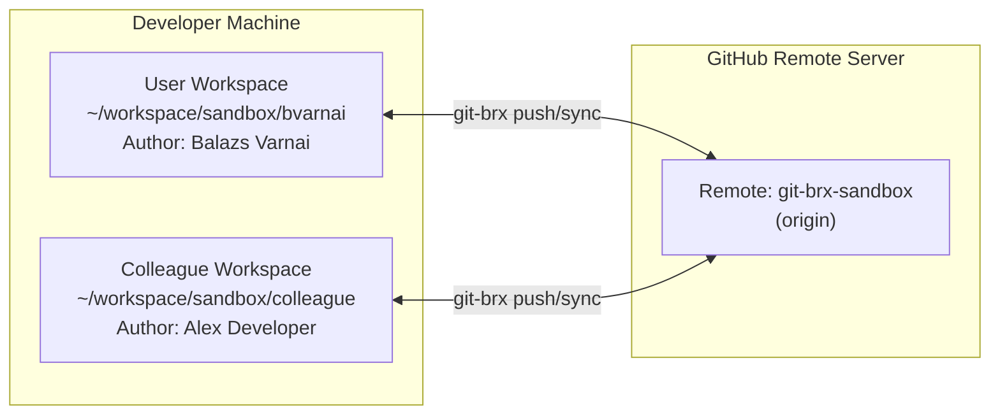
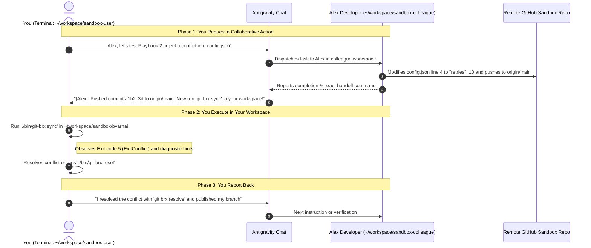

# Colleague simulation & multi-developer testing guide

Testing real-world collaborative Git workflows—such as rebasing over upstream merges, resolving merge conflicts, and pair-programming on shared branches—normally requires multiple developers or tedious manual juggling of Git clones and identities.

`git-brx` includes an end-to-end **Colleague Simulation Harness** featuring **"Alex Developer"**, an autonomous AI peer agent running in Antigravity CLI (`agy`). Alex operates in an isolated workspace clone with their own Git author identity, allowing you to test complex, multi-developer scenarios side-by-side in real time.

---

## 1. Architecture & workspace topology



### Identity decoupling
Both workspaces target the same GitHub repository (`git-brx-sandbox`), but use distinct local Git configurations:
- **User Workspace (`sandbox/bvarnai`):** Inherits your standard Git settings (`Balazs Varnai <bvarnai@gmail.com>`).
- **Colleague Workspace (`sandbox/colleague`):** Configured with Alex's identity (`Alex Developer <alex.developer@example.com>`).

This guarantees that Git commits, author history, and logs cleanly distinguish between both engineers.

---

## 2. One-time setup & provisioning

Run the automated provisioning script from the `git-brx` root:

```bash
GITHUB_TOKEN="<your_pat>" ./scripts/setup-sandbox.sh
```

### What the setup script does:
1. Verifies that `bvarnai/git-brx-sandbox` exists on GitHub (or instructs you to create it).
2. Clones the repository into `/home/bvarnai/workspace/sandbox/bvarnai`.
3. Clones the repository into `/home/bvarnai/workspace/sandbox/colleague`.
4. Sets local `git config user.name` and `user.email` in each clone.
5. Symlinks the current `./bin/git-brx` binary into both workspaces under `./bin/git-brx`.
6. Seeds initial starter files on `main` (`calc.go`, `config.json`, `README.md`) if newly created.

---

## 3. Turn-based interaction model

To ensure you maintain complete control over each step and are never rushed, the simulation follows a **turn-based checkpoint model**:



---

## 4. Example message flows

### Example Flow A: Simulating an upstream merge & rebase sync (`git brx sync`)

#### Prompt to Antigravity:
> *"Alex, I am starting work on `feature/user-profile` in `sandbox/bvarnai`. While I work on this, please implement a new function in `calc.go`, commit it, and merge it directly into `main` on origin."*

#### Alex's response in Chat:
> `[Alex Developer]:`
> I switched to `main` in `~/workspace/sandbox/colleague`, implemented `func Subtract(a, b int) int` in `calc.go`, and pushed commit `7f21a9c` directly to `origin/main`.
>
> **Your Turn:**
> Switch to `~/workspace/sandbox/bvarnai` and run:
> ```bash
> ./bin/git-brx sync
> ```
> `git-brx` will fetch `origin/main`, detect that `main` is ahead by 1 commit, and cleanly rebase your `feature/user-profile` branch on top of my new commit!

---

### Example Flow B: Injecting a merge conflict (`git brx resolve` / `git brx reset`)

#### Prompt to Antigravity:
> *"Alex, let's simulate a merge conflict. I just changed line 4 of `config.json` on my branch to `"retries": 5`. Please push a conflicting change on `origin/main`."*

#### Alex's response in Chat:
> `[Alex Developer]:`
> I've edited line 4 of `config.json` in `~/workspace/sandbox/colleague` to `"retries": 10`, committed as `Alex Developer`, and pushed to `origin/main` (commit `3b8d104`).
>
> **Your Turn:**
> In `~/workspace/sandbox/bvarnai`, run:
> ```bash
> ./bin/git-brx sync
> ```
> Expected behavior:
> 1. `git-brx` halts with Exit code 5 (`ExitConflict`).
> 2. You will see the hint: `Use 'git-brx resolve' to resolve conflicts, or 'git-brx reset' to abort`.
> 3. You can either fix the conflict markers in `config.json` and run `./bin/git-brx resolve`, or abort cleanly with `./bin/git-brx reset`.

---

### Example Flow C: Pair-programming on a shared topic branch (`git brx update`)

#### Prompt to Antigravity:
> *"Alex, I just published `feature/shared-pipeline` from `sandbox/bvarnai`. Please pull it down in your workspace, add a second step, and push it back to origin."*

#### Alex's response in Chat:
> `[Alex Developer]:`
> I ran `./bin/git-brx select feature/shared-pipeline` in `~/workspace/sandbox/colleague`, added `Step 2: Validation` to the pipeline file, and pushed commit `8c91d2e` to `origin/feature/shared-pipeline`.
>
> **Your Turn:**
> In `~/workspace/sandbox/bvarnai`, run:
> ```bash
> ./bin/git-brx update
> ```
> `git-brx` will autostash any uncommitted work and rebase cleanly over my latest commit!

---

## 5. Resetting the sandbox environment

If you want to wipe local changes and start completely fresh from GitHub `origin/main`:

```bash
./scripts/setup-sandbox.sh --reset
```

This cleans both `sandbox/bvarnai` and `sandbox/colleague` and re-clones a pristine copy from `origin/main`.
