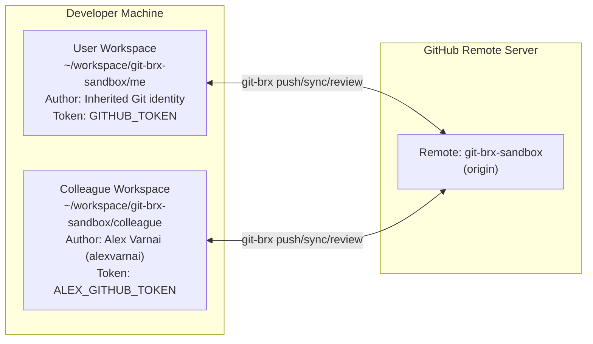
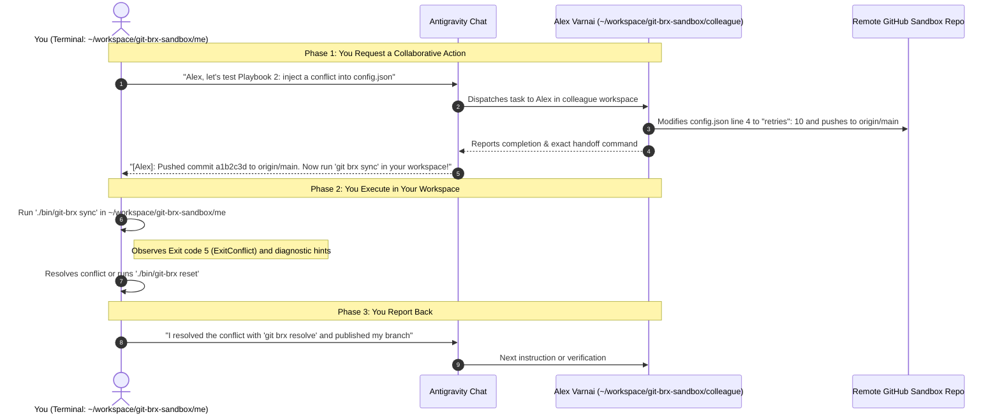

# Colleague simulation & multi-developer testing guide

Testing real-world collaborative Git workflows—such as rebasing over upstream merges, resolving merge conflicts, and pair-programming on shared branches—normally requires multiple developers or tedious manual juggling of Git clones and identities.

`git-brx` includes an end-to-end **Colleague Simulation Harness** featuring **"Alex Varnai"** (`alexvarnai` on GitHub, `alexvarnai@users.noreply.github.com`), an autonomous AI peer agent running in Antigravity CLI (`agy`). Alex operates in an isolated workspace clone with their own Git author identity and personal access token (`ALEX_GITHUB_TOKEN`), allowing you to test complex, multi-developer scenarios—including reviewer mapping and author exclusion—side-by-side in real time.

---

## 1. Architecture & workspace topology



### Identity decoupling
Both workspaces target the same GitHub repository (`git-brx-sandbox`), but use distinct local Git configurations:
- **User Workspace (`git-brx-sandbox/me`):** Inherits your standard global Git settings (`git config user.name`/`user.email`) and `GITHUB_TOKEN`.
- **Colleague Workspace (`git-brx-sandbox/colleague`):** Configured with Alex's identity (`Alex Varnai <alexvarnai@users.noreply.github.com>`, GitHub handle `alexvarnai`) and `ALEX_GITHUB_TOKEN`.

This guarantees that Git commits, author history, reviewer routing, and logs cleanly distinguish between both engineers.

---

## 2. One-time setup & shell activation

Run the automated provisioning script from the `git-brx` root:

```bash
ADMIN_GITHUB_TOKEN="ghp_..." \
ME_GITHUB_TOKEN="github_pat_..." \
ALEX_GITHUB_TOKEN="github_pat_..." \
./scripts/setup-sandbox.sh
```

### GitHub Token Permissions Reference

The simulation environment uses a 3-token least-privilege architecture:

| Token Role | Environment Variable | Account | Recommended Scope / Permissions | Why It's Needed |
| :--- | :--- | :--- | :--- | :--- |
| **Admin Token** | `ADMIN_GITHUB_TOKEN` | Primary (`bvarnai`) | **Classic PAT** (`repo`, `admin:repo_hook`) or Admin fine-grained | Repository lifecycle provisioning & deletion (`git-brx-sandbox`), inviting `alexvarnai` as collaborator. |
| **Primary Developer** | `ME_GITHUB_TOKEN` | Primary (`bvarnai`) | **Fine-grained PAT** (All repos or `git-brx-sandbox`):<br>• **Contents:** `Read-only` *(Required for private repos)*<br>• **Pull requests:** `Read and write`<br>• **Issues:** `Read-only`<br>• **Metadata:** `Read-only` *(required)* | Injected into `env.sh` for developer operations in `git-brx-sandbox/me` (`create`, `publish`, `review`, `delete`). |
| **Colleague** | `ALEX_GITHUB_TOKEN` | Colleague (`alexvarnai`) | **Fine-grained PAT** (All repos or `git-brx-sandbox`):<br>• **Contents:** `Read-only` *(Required for private repos)*<br>• **Pull requests:** `Read and write`<br>• **Issues:** `Read-only`<br>• **Metadata:** `Read-only` *(required)* | Injected into `env-colleague.sh` for Alex's operations in `git-brx-sandbox/colleague`. |

> [!IMPORTANT]
> **Why `Contents: Read-only` is required on Private Repositories:**
> * On **public** repositories, GitHub's git engine automatically allows tokens to inspect commits, diffs, and branch references without explicit permissions.
> * On **private** repositories (like `git-brx-sandbox`), GitHub governs branches and commits under the **Contents** permission (*"Repository contents, commits, branches, downloads, releases, and merges"*).
> * When opening a Pull Request (`POST /repos/{owner}/{repo}/pulls`), GitHub's backend must read the commits between `head` and `base`. If `Contents: Read-only` is missing on a private repo, GitHub rejects PR creation with `422 Validation Failed (not all refs are readable)`.

### What the setup script does:
1. Dynamically detects your authenticated GitHub account and ensures `git-brx-sandbox` exists.
2. Invites `alexvarnai` as a collaborator with write (`push`) permissions.
3. Seeds test issues (#1..#4) for turnkey scenario execution.
4. Clones the repository into `~/workspace/git-brx-sandbox/me` and `~/workspace/git-brx-sandbox/colleague`.
5. Pre-configures `.git-brx.yaml` with the documentation and lead reviewer mapping.
6. Generates `~/workspace/git-brx-sandbox/env.sh` (for you) and `env-colleague.sh` (for Alex) with injected PATs and permissions secured (`chmod 700`).

### Activating your shell
In any terminal where you want to work as yourself:

```bash
source ~/workspace/git-brx-sandbox/env.sh
cd ~/workspace/git-brx-sandbox/me
```

This immediately:
- Prepends `git-brx/bin` to your `PATH` so `git brx` executes the local compiled binary.
- Enables Bash tab autocompletion for both `git-brx` and `git brx`.

---

## 3. Turn-based interaction model

To ensure you maintain complete control over each step and are never rushed, the simulation follows a **turn-based checkpoint model**:



---

## 4. Example message flows

### Example Flow A: Simulating an upstream merge & rebase sync (`git brx sync`)

#### Prompt to Antigravity:
> *"Alex, I am starting work on `feature/1` in `git-brx-sandbox/me`. While I work on this, please implement a new function in `calc.go`, commit it, and merge it directly into `main` on origin."*

#### Alex's response in Chat:
> `[Alex Varnai]:`
> I switched to `main` in `~/workspace/git-brx-sandbox/colleague`, implemented `func Subtract(a, b int) int` in `calc.go`, and pushed commit `7f21a9c` directly to `origin/main`.
>
> **Your Turn:**
> Switch to `~/workspace/git-brx-sandbox/me` and run:
> ```bash
> git brx sync
> ```
> `git-brx` will fetch `origin/main`, detect that `main` is ahead by 1 commit, and cleanly rebase your `feature/1` branch on top of my new commit!

---

### Example Flow B: Injecting a merge conflict (`git brx resolve` / `git brx reset`)

#### Prompt to Antigravity:
> *"Alex, let's simulate a merge conflict. I just changed line 4 of `config.json` on my branch to `"retries": 5`. Please push a conflicting change on `origin/main`."*

#### Alex's response in Chat:
> `[Alex Varnai]:`
> I've edited line 4 of `config.json` in `~/workspace/git-brx-sandbox/colleague` to `"retries": 10`, committed as `Alex Varnai`, and pushed to `origin/main` (commit `3b8d104`).
>
> **Your Turn:**
> In `~/workspace/git-brx-sandbox/me`, run:
> ```bash
> git brx sync
> ```
> Expected behavior:
> 1. `git-brx` halts with Exit code 5 (`ExitConflict`).
> 2. You will see the hint: `Use 'git-brx resolve' to resolve conflicts, or 'git-brx reset' to abort`.
> 3. You can either fix the conflict markers in `config.json` and run `git brx resolve`, or abort cleanly with `git brx reset`.

---

### Example Flow C: Pair-programming on a shared topic branch (`git brx update`)

#### Prompt to Antigravity:
> *"Alex, I just published `feature/4` from `git-brx-sandbox/me`. Please pull it down in your workspace, add a second step, and push it back to origin."*

#### Alex's response in Chat:
> `[Alex Varnai]:`
> I ran `git brx select feature/4` in `~/workspace/git-brx-sandbox/colleague`, added `Step 2: Validation` to the pipeline file, and pushed commit `8c91d2e` to `origin/feature/4`.
>
> **Your Turn:**
> In `~/workspace/git-brx-sandbox/me`, run:
> ```bash
> git brx update
> ```
> `git-brx` will autostash any uncommitted work and rebase cleanly over my latest commit!

---

### Example Flow D: Testing Reviewer Routing & Author Exclusion (`git brx review`)

#### Routing Policy:
- **`docs/**`**: Routed to `alexvarnai`
- **Lead / Default**: All other changes routed to `bvarnai`

#### Prompt to Antigravity:
> *"Alex, please create a feature branch in `git-brx-sandbox/colleague`, edit `calc.go`, and submit a review using your PAT. Verify that `bvarnai` is assigned as reviewer rather than you."*

#### Alex's response in Chat:
> `[Alex Varnai]:`
> I checked out `feature/2` in `~/workspace/git-brx-sandbox/colleague`, added changes to `calc.go`, and submitted the PR via `git brx review`.
> Since `calc.go` is code rather than documentation, `git-brx` routed the PR to team lead `bvarnai` via `mapping.default`.
>
> **Your Turn:**
> In `~/workspace/git-brx-sandbox/me`, create a branch with documentation in `docs/architecture.md`, publish, and run `git brx review`. `git-brx` will match `docs/**` and request review from `alexvarnai`!

---

## 5. Resetting the sandbox environment

If you want to wipe local changes and start completely fresh from GitHub `origin/main`:

```bash
./scripts/setup-sandbox.sh --reset
```

This cleans both `git-brx-sandbox/me` and `git-brx-sandbox/colleague` and re-clones a pristine copy from `origin/main`.
