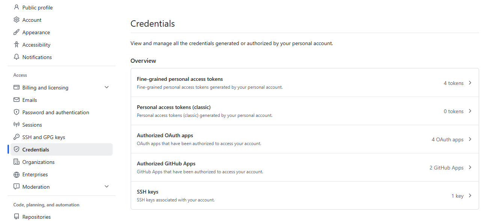
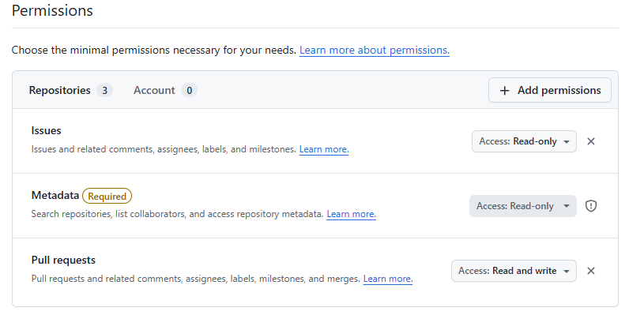
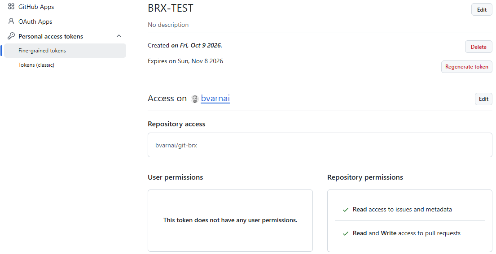

# Multi-platform setup

`git-brx` is architected with a decoupled provider model to support multiple issue trackers and code review systems.

## Platform support status

| Platform / Backend | Issue Tracker | Code Review (PR / MR) | Status | Notes |
| :--- | :--- | :--- | :--- | :--- |
| **GitHub** | GitHub Issues | GitHub Pull Requests | **Done** | Tested and verified in real-world usage. |
| **Atlassian (Bitbucket + Jira)** | Jira Server / DC | Bitbucket Server / DC | **Implemented (untested)** | Client code and unit tests present; not yet tested on live instances. |
| **Hybrid (Jira + GitHub)** | Jira Server / DC | GitHub Pull Requests | **Implemented (untested)** | Client code present; needs real-world testing. |
| **GitLab** | GitLab Issues | GitLab Merge Requests | **Not yet implemented** | Planned for future release. |
| **Bitbucket Cloud** | Jira Cloud / Bitbucket | Bitbucket Cloud PRs | **Not yet implemented** | Planned for future release. |

---

## 1. Zero-config & partial-config modes (Remote auto-detection)

### Zero-config mode
If your repository uses GitHub, you **do not need any `.git-brx.yaml` file at all**.

When `git-brx` initializes, it inspects your remote origin URL:
- `git@github.com:my-org/my-project.git` ➔ Configures `platform: github`, `owner: my-org`, `repo: my-project`.

All branch naming rules and issue validations immediately work with standard defaults.

### Partial-config mode
When you create a `.git-brx.yaml` to customize specific rules (such as custom `branch.mapping` or `review.mapping`) but omit `platform:`, `git-brx` automatically falls back to detecting your platform from the remote `origin` URL. You only need to define what you want to customize:

```yaml
# .git-brx.yaml
branch:
  mapping:
    enhancement: "issue"
```

In this case, `git-brx` detects `platform: github` from `origin`, auto-populates GitHub issue tracker and code review presets, and applies your custom branch mapping.

### Disabling platform integrations (`platform: none`)
If you want to maintain a `.git-brx.yaml` file (for example, to enforce branch naming templates or local workflows) but disable remote issue tracker checks and review integrations entirely, explicitly set:

```yaml
# .git-brx.yaml
platform: none
```

---

## 2. GitHub configuration (Done)

To customize GitHub integration, place `.git-brx.yaml` in your repository root:

```yaml
platform: github

# Reviewer Routing & Merge Configuration
review:
  merge:
    instructions: true              # Injects merge strategy guidance and branch cleanup into PR
    strategy: squash                 # Global fallback strategy (squash | merge | rebase)
    strategies:
      sources:                       # Match against PR source branch (HEAD)
        "epic/*": merge
        "release/*": merge
      targets:                       # Match against PR target branch (BASE)
        "epic/*": merge
        "release/*": merge
  template: .github/pull_request_template.md
  mapping:
    paths:
      "internal/ui/**": [carol, dave]
      "internal/git/**": [bob]
      "docs/**": [tech-writer]
    labels:
      security: [charlie]
      backend: [alice, bob]
    branches:
      "epic/*": [lead-architect]
    default: [team-lead]            # Fallback reviewer
```

### Authentication & Personal Access Token (PAT) setup:
`git-brx` communicates with GitHub's REST API during `git brx create` (to inspect issues and labels), `git brx review` (to open Pull Requests), and `git brx delete` (to verify remote PR status).

`git-brx` resolves your token from the following sources in order:
1. `GITHUB_TOKEN` environment variable.
2. `GH_TOKEN` environment variable.
3. System Git credential helper (`git credential fill`).

#### Step 1: Navigate to Token Settings
1. In GitHub, click your profile icon in the top right and select **Settings**.
2. In the left navigation sidebar under **Access**, click **Credentials** (or **Developer settings** $\to$ **Personal access tokens** depending on your GitHub layout).
3. Select **Fine-grained personal access tokens** (or **Fine-grained tokens**).
4. Click **Generate new token**.



#### Step 2: Configure Repository Access
In the **Repository access** section:
- Select **Only select repositories** and choose your repository (e.g. `owner/repo`), or select **All repositories** if you use `git-brx` across all your projects.

#### Step 3: Required Permissions for `git-brx`
`git-brx` operates under the principle of least privilege. You only need to grant the following minimal repository permissions:

| Permission Category | Scope | Access Level | Why `git-brx` needs it |
| :--- | :--- | :--- | :--- |
| **Repository permissions** | **Issues** | **Read-only** | Fetches issue title, status, and labels when running `git brx create <branch>` to validate branch prefixes (`issue/`, `feature/`, `epic/`). |
| **Repository permissions** | **Metadata** *(Required)* | **Read-only** | Enforced by GitHub for repository discovery and collaborator checks. |
| **Repository permissions** | **Pull requests** | **Read and write** | Opens automated pull requests during `git brx review` and verifies PR merge status during `git brx delete`. |
| **User / Account permissions** | *(None)* | *None* | `git-brx` does **not** require any user or account-level permissions. |



Once configured, verify your token overview matches the required scopes:



#### Step 4: Export the Token
Generate and copy your token (starting with `github_pat_...`), then export it in your shell environment (`~/.bashrc`, `~/.zshrc`, or Git Bash):
```bash
export GITHUB_TOKEN="github_pat_xxxxxxxxxxxxxxxxxxxx"
# or
export GH_TOKEN="github_pat_xxxxxxxxxxxxxxxxxxxx"
```

### Git-native authentication (SSH vs. HTTPS) vs. API tokens

A common question is how Git-native authentication (SSH keys or HTTPS credentials) interacts with GitHub Personal Access Tokens:

| Layer | Transport / Client | Authentication Credential | Responsibilities in `git-brx` |
| :--- | :--- | :--- | :--- |
| **Git Wire Transport** | Git protocol via SSH (`git@github.com:...`) or HTTPS (`https://github.com/...`) | SSH Key (`~/.ssh/id_*` / ssh-agent) or Git Credential Manager | Transferring commits, pushing branches (`git brx publish`), fetching remotes (`git fetch`), and branch rebasing. |
| **Platform REST API** | HTTPS REST requests to `api.github.com` | Personal Access Token (`GITHUB_TOKEN` / `GH_TOKEN`) | Issue metadata validation (`git brx create`), Pull Request creation (`git brx review`), and PR status inspection (`git brx delete`). |

> [!NOTE]
> **Can using SSH be a problem?** Not at all. Using an SSH key for Git operations while using a Personal Access Token for GitHub REST API calls is the standard, secure configuration. When `git-brx publish` pushes a branch, it invokes standard Git, which seamlessly uses your SSH key.


### Recommended GitHub Repository Settings for Squash Merges:
> [!TIP]
> To ensure GitHub always pre-populates the squash commit message using the clean PR title generated by `git-brx` (`feat(#<issue>): <summary> (#<pr>)`):
> 1. In your GitHub repository, open **Settings** $\to$ **General**.
> 2. Under **Pull Requests** $\to$ **Allow squash merging**, change the dropdown to **Pull request title** (or **Pull request title and commit details**).
>
> If left on GitHub's repository default ("Default message"), GitHub populates the squash title from the *single commit message* when a PR has only 1 commit, rather than using the PR title.


### Branch prefix & label mapping on GitHub:
When creating a branch via `git brx create <branch>`, `git-brx` validates the target issue's labels to ensure branch prefixes match the nature of the change:
* **Labels `bug` or `defect` $\to$ `issue/`:** Restricted to bugfixes and patches.
* **Labels `enhancement`, `feature`, or `story` $\to$ `feature/`:** Reserved for backlog features and stories.
* **Label `epic` $\to$ `epic/`:** Reserved for large initiatives.
* **Unlabeled issues $\to$ `issue/`:** Default fallback if no category label is attached.

#### Custom GitHub label mapping
If your team uses custom label taxonomies (e.g. `kind/feature`, `type:bug`) or if you want to override default label behaviors, configure `branch.mapping` directly in `.git-brx.yaml`:

```yaml
branch:
  mapping:
    # Direct raw GitHub labels (case-insensitive):
    "kind/feature": "feature"
    "kind/bug": "issue"
    "enhancement": "issue"   # map enhancement to issue/ instead of feature/

    # Jira / domain types:
    Bug: "issue"
    Story: "feature"
```

Direct raw label matches take precedence over inferred domain types (`Story`, `Bug`, `Epic`). Matching is case-insensitive.

If you attempt to create `feature/10` for an issue labeled `bug` (or unlabeled without a mapping), `git-brx` guards against mismatched categorization:
```text
[git-brx] Error: Issue type 'Bug' is not allowed on 'feature' branch
[git-brx] Hint: use 'issue' branch or check mapping rules
```

---

## 3. Atlassian Bitbucket Server & Jira configuration (Implemented, untested)

> [!NOTE]
> Client code and mock test suites exist for Bitbucket Server and Jira REST APIs, but this backend has **not yet been verified against live production instances**. If you test this configuration, please report any issues on GitHub.

For on-premises Atlassian enterprise deployments (Bitbucket Server / Data Center and Jira Server):

```yaml
platform: bitbucket

tracker:
  provider: jira
  project: VSB
  uri: https://jira.internal.example.com

scm:
  provider: bitbucket
  project: VSB
  repo: core-tools
  uri: https://bitbucket.internal.example.com

branch:
  template: "^(?P<type>issue|feature|epic)/(?P<key>VSB-\\d+)$"
  mapping:
    Bug: issue
    Technical Item: issue
    Backlog: feature
    Epic: epic

review:
  merge:
    instructions: true
  template: etc/review-template.md
  mapping:
    labels:
      UI: [jsmith, mjones]
      Database: [dba-team]
    default: [lead-dev]
```

### Authentication:
Set your Personal Access Token (PAT) via:
```bash
export GIT_BRX_TOKEN="your_atlassian_pat"
```

---

## 4. Hybrid setups: Jira + GitHub (Implemented, untested)

> [!NOTE]
> Hybrid support (Jira for issue tracking and GitHub for code review) is implemented but untested in live workflows.

```yaml
# Issue tracking handled by Jira
tracker:
  provider: jira
  project: PROJ
  uri: https://jira.internal.example.com

# Code review handled by GitHub
scm:
  provider: github
  owner: my-org
  repo: backend-service

review:
  merge:
    instructions: true
  template: .github/pull_request_template.md
  mapping:
    labels:
      core: [alice]
      api: [bob]
    default: [charlie]
```

When you run:
- `git brx create issue/TASK-101`: Validates against **Jira**.
- `git brx review`: Creates the pull request on **GitHub**, automatically linking back to Jira ticket `TASK-101`.

---

## 5. Branch protection rules & repository permissions

To maintain an orderly and reproducible codebase, remote Git hosting platforms (GitHub, Bitbucket Server, GitLab) enforce access control through **repository permissions** and **branch protection rules**.

### Developer Git permissions
`git-brx` assumes standard developer permissions:
* **Read / Clone access:** Required to fetch remotes, inspect commits, and discover branches.
* **Write / Push access:** Required to publish topic branches (`issue/*`, `feature/*`, `epic/*`) to the remote repository (`git brx publish`).

> [!NOTE]
> External contributors working on public forks who lack direct push access can still run `git-brx` locally, but `git brx publish` will be rejected by the upstream remote if push access is restricted.

### Branch protection rules (Base branches vs. Topic branches)

`git-brx` workflows are designed around branch protection and isolation:

| Branch Category | Target Branches | Recommended Protection Rules | Why |
| :--- | :--- | :--- | :--- |
| **Base Branches** | `main`, `master`, `release/*` | • Require pull requests before merging<br>• Prevent direct pushes<br>• Prevent branch deletion<br>• Prevent force pushes (history rewriting) | `git-brx` treats base branches as the production single source of truth. Developers never commit or push directly to `main`; all changes integrate via automated pull requests (`git brx review`). |
| **Topic Branches** | `issue/*`, `feature/*`, `epic/*` | • Allow force-pushes with lease (`--force-with-lease`)<br>• Allow branch deletion after merge<br>• Full control by developers | `git-brx` uses rebase workflows (`git brx update`, `git brx sync`) to keep history clean and linear. Rebasing changes commit hashes, requiring leased force-pushes during `git brx publish`. |

> [!WARNING]
> **Avoid wildcard branch protection on topic branches:**
> If your repository administrator configures a blanket branch protection rule or ruleset matching all branches (`*`) that disables force-pushes or requires pull requests to update branches, `git brx publish` will fail when pushing rebased topic branches. Always scope branch protection rules strictly to `main`, `master`, and `release/*`.

---

## 6. Other platforms (Not yet implemented)

Support for the following platforms is not yet implemented:
- **GitLab:** Native support for GitLab Issues and Merge Requests.
- **Bitbucket Cloud:** Atlassian Cloud 2.0 REST API support.

