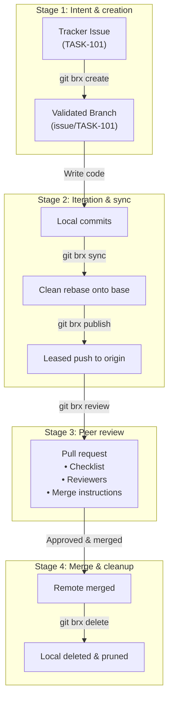

# Core philosophy & mental model

## 1. Workflow over commands: the origin of `git-brx`

`git-brx` comes from my former team, where Git adoption was a struggle. In my experience, the hardest hurdle for beginners is truly understanding Git's dual nature—being local and remote at the same time. After struggling to teach them individual Git commands, I created a few shell scripts used as Git aliases to automate common repository tasks. I quickly realized that having a built-in workflow was essential. Most of the effort went into creating a workflow as simple as possible to support fast, low-overhead development.

---

## 2. Issue-driven development: the single source of truth

At the heart of `git-brx` is a strict organizational philosophy: **every code change belongs to a tracked issue (a ticket in Jira or GitHub).**

```
┌────────────────────────────────────────────────────────┐
│                   THE ISSUE (Jira / GitHub)            │
│  • What is the problem?                                │
│  • Why is this change necessary?                       │
│  • What are the acceptance criteria & edge cases?      │
│  • What is the test and verification plan?             │
└───────────────────────────┬────────────────────────────┘
                            │
              1:1 Link      ▼
┌────────────────────────────────────────────────────────┐
│             THE PULL REQUEST (Code Review)             │
│  • How is the solution architected?                    │
│  • Are unit and integration tests passing?             │
│  • Is the code readable, secure, and maintainable?     │
│  • Strictly for technical peer review!                 │
└────────────────────────────────────────────────────────┘
```

### Why separate the "What" from the "How"?

In many development teams, pull requests suffer from **Scope creep during review**:
- An engineer opens a PR with minimal explanation
- Reviewers spend days debating what the feature was actually supposed to do
- Halfway through code review, stakeholders realize core business requirements were misunderstood

`git-brx` enforces a clean division of responsibility:

| Artifact | Primary audience | Core purpose | Discussion topics |
| :--- | :--- | :--- | :--- |
| **The issue** | Product managers, QA, engineers, stakeholders | **Source of truth:** Defines *What* needs to be done and *Why*. Contains specifications, acceptance criteria, reproducible steps, and test plans | Business requirements, edge cases, scope, user expectations |
| **The pull request** | Engineering peers | **Quality assurance:** Inspects *How* the code implements the issue. Verifies architecture, style, test coverage, and performance | Implementation details, code structure, algorithm efficiency, test assertions |

When a developer runs `git brx create issue/TASK-101`, `git-brx` reaches out to the issue tracker, verifies that `TASK-101` is a valid, assigned ticket, and sets up a local workspace directly linked to that contract.

---

## 3. Branch types and their roles: convention over configuration

To standard Git, all branch names look identical. A branch named `fix-typo` and a branch named `cloud-migration` are just arbitrary pointers to a commit.

Because Git does not understand the intended role of a branch, developers are constantly forced to make low-level decisions:
- *"Should I rebase or merge this branch?"*
- *"If I force-push, will I overwrite my teammate's work?"*
- *"Should this pull request be squashed or merged with a merge commit?"*

`git-brx` eliminates this decision fatigue by giving each **branch type** a clear, built-in **role**:

| Branch type | Team role & lifespan | `sync` strategy | PR merge strategy | Why this type behaves this way |
| :--- | :--- | :--- | :--- | :--- |
| **`issue/<id>`** | **Solo task:** focused bugfixes & tech debt (hours to days) | **Linear rebase** | **Squash & merge** | Single-author work stays strictly linear. Squashing on `main` keeps history bisectable (`git bisect`) while giving engineers the freedom to make messy micro-commits locally |
| **`feature/<id>`** | **Collaborative feature:** shared stories & capabilities (days to weeks) | **3-way merge** | **Squash & merge** *(or merge commit)* | Multiple teammates share the branch. 3-way merge prevents history rewrites and avoids broken tracking for collaborators |
| **`epic/<id>`** | **Major initiative:** multi-sprint milestones (weeks to months) | **3-way merge** | **Merge commit (`--no-ff`)** | Long-running initiatives preserve all constituent commits grouped under a clear merge bubble on `main` |

**The branch type declares the role.** Once you name your branch, `git-brx` automatically applies the right synchronization and review behavior behind the scenes—no manual flags or configuration required.

> [!NOTE]
> **Local scratch work is always supported:** For throwaway experiments, local prototypes, or scratch spikes without an issue, standard Git (`git checkout -b scratch-test`) remains fully available alongside `git-brx`.

---

## 4. The 4-Stage workflow cycle



### Stage 1: Intent & creation (`git brx create`)
You never branch from stale or arbitrary commits. `git-brx create` validates that you have an assigned task in Jira or GitHub, validates the naming convention, and branches directly off the latest base branch.

### Stage 2: Iteration & sync (`git brx sync` / `git brx publish`)
As you work, other teammates will merge changes into `main` or `master`. Instead of allowing your branch to drift into a divergence nightmare, you run `git brx sync`. For standard issue branches, `git-brx` performs a clean, linear **rebase**, replaying your commits on top of the latest trunk.

When you're ready to share your work or backup your commits, `git brx publish` pushes with `--force-with-lease` and establishes upstream tracking automatically.

### Stage 3: Peer review (`git brx review`)
When your implementation is complete and verified, running `git brx review` assembles a pull request. It automatically:
1. Links the parent Issue
2. Injects your team's quality checklist (tests, docs, edge cases)
3. Evaluates modified components and routes the PR to the appropriate code reviewers
4. Appends standardized, timeless merge instructions

### Stage 4: Merge & cleanup (`git brx delete`)
Once approved and merged, local branch clutter can become overwhelming. `git brx delete` queries your SCM provider to ensure the branch was truly merged, switches your working tree safely back to `main`, deletes the local branch, and prunes stale remote references.
