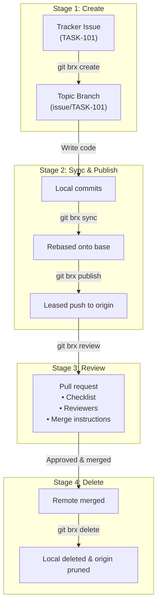

# Core philosophy & mental model

## 1. Workflow over commands: the origin of `git-brx`

`git-brx` grew out of a team where Git adoption was a recurring bottleneck. The hardest part for engineers new to Git is keeping track of local state versus remote state across fetch, rebase, merge, and push operations. Teaching individual Git flags didn't stick; giving the team a small set of workflow commands with built-in guardrails did. `git-brx` packages that workflow into a single static binary.

---

## 2. Issue-driven development: single source of truth

In `git-brx`, **every tracked code change maps to an issue in Jira or GitHub.**

```
┌────────────────────────────────────────────────────────┐
│                   THE ISSUE (Jira / GitHub)            │
│  • What is the problem?                                │
│  • Why is this change needed?                          │
│  • What are the acceptance criteria & edge cases?      │
│  • What is the verification and test plan?             │
└───────────────────────────┬────────────────────────────┘
                            │
               1:1 Link     ▼
┌────────────────────────────────────────────────────────┐
│             THE PULL REQUEST (Code Review)             │
│  • How is the change implemented?                      │
│  • Are unit and integration tests passing?             │
│  • Is the code clear, safe, and maintainable?          │
│  • Focused strictly on technical review                │
└────────────────────────────────────────────────────────┘
```

### Separating "What" from "How"

Without a clear boundary between issues and pull requests, scope debates spill into code review:
- A developer opens a PR with little context.
- Reviewers spend days debating what the feature is supposed to do instead of reviewing the code.
- Missing requirements surface only after the code is written.

`git-brx` separates the two concerns:

| Artifact | Primary audience | Purpose | Discussion scope |
| :--- | :--- | :--- | :--- |
| **The issue** | Product, QA, engineers | **Defines *What* and *Why*:** Specifications, acceptance criteria, reproduction steps, and test plans | Requirements, edge cases, scope, user impact |
| **The pull request** | Engineering peers | **Reviews *How*:** Architecture, correctness, test coverage, and performance | Implementation details, code structure, edge-case handling, tests |

When you run `git brx create issue/TASK-101`, `git-brx` queries the issue tracker, checks that `TASK-101` exists and matches the branch prefix, and creates the local topic branch.

---

## 3. Branch types and their roles

To plain Git, all branch names are identical—`fix-typo` and `cloud-migration` are just commit pointers. Because Git doesn't know a branch's purpose, developers have to decide manually on every task:
- *"Should I rebase or merge `main` into this branch?"*
- *"Will force-pushing overwrite a teammate's commits?"*
- *"Should this PR be squashed or merged with `--no-ff`?"*

`git-brx` encodes those decisions into three branch prefixes:

| Branch type | Scope & lifespan | `sync` strategy | PR merge strategy | Rationale |
| :--- | :--- | :--- | :--- | :--- |
| **`issue/<id>`** | **Solo task:** bug fixes & small tasks (hours to days) | **Linear rebase** | **Squash & merge** | Single-author work stays linear. Squashing onto `main` keeps history clean for `git bisect` while letting you make small work-in-progress commits locally. |
| **`feature/<id>`** | **Shared feature:** multi-person stories (days to weeks) | **3-way merge** | **Squash & merge** *(or merge commit)* | Multiple developers can push to the same branch without rewriting shared commit history. |
| **`epic/<id>`** | **Multi-PR initiative:** larger milestones (weeks to months) | **3-way merge** | **Merge commit (`--no-ff`)** | Preserves individual commits on `main` under an explicit merge commit. |

Once you name a branch, `git-brx` selects the matching `sync` strategy and PR merge instructions automatically.

> [!NOTE]
> **Local spikes and experiments:** For quick prototypes without an issue ticket, use standard Git (`git checkout -b scratch-test`).

---

## 4. The 4-stage workflow



### Stage 1: Create (`git brx create`)
Checks that the issue exists in Jira or GitHub, validates the branch prefix against the issue type, and creates the branch from your current base branch.

### Stage 2: Sync & publish (`git brx sync` / `git brx publish`)
As teammates merge changes into `main`, run `git brx sync` to keep your branch current (rebasing `issue/*` branches or merging `main` into `feature/*` and `epic/*` branches).

Run `git brx publish` to push your branch to `origin` using `--force-with-lease` and configure upstream tracking.

### Stage 3: Review (`git brx review`)
When the change is ready for review, `git brx review` opens a pull request:
1. Links the parent issue (`Closes #<id>`).
2. Populates your repository's PR template.
3. Matches modified file paths, issue labels, or branch patterns to assign reviewers (excluding the PR author).
4. Appends merge strategy instructions (`Squash and merge` or `Create a merge commit`).

### Stage 4: Delete (`git brx delete`)
After the PR is merged and the remote branch is removed on `origin`, `git brx delete` switches your working tree back to `main`, deletes the local topic branch, and prunes stale `origin/*` tracking refs.
